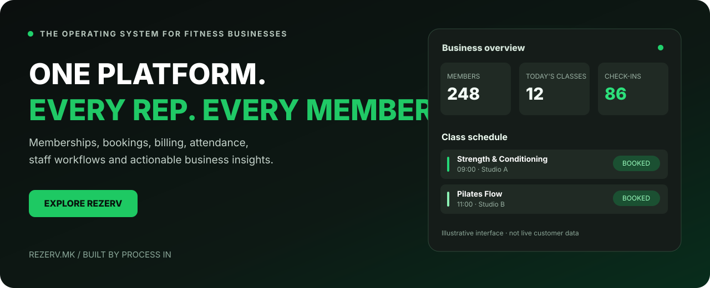

# REZERV

[Македонски](README.mk.md) · [English](README.md) · [Shqip](README.sq.md) · [Türkçe](README.tr.md)

**Daha az idare. Üyelere daha çok zaman.**

**LIVE**

## Fitness işletmesinin işletim sistemi

**PROCESS IN** ürünü **REZERV.mk** spor salonlarına, butik stüdyolara, Pilates, yoga, dans, kişisel antrenörlük, dövüş sanatları ve spor akademilerine yöneliktir.

Üyeler açık rezervasyon ve geçerli üyelik; antrenörler düzenli program; sahipler ödeme, katılım ve iş görünümü ister. REZERV bunları birleştirir.

## Temel alanlar

| Alan | Yönetim |
|---|---|
| **Üye ve müşteri** | Kayıt, durum, yaşam döngüsü ve yenileme. |
| **Üyelik ve paket** | Plan, kullanım, hak, kural ve süre sonu. |
| **Online rezervasyon** | Uygun ders, seans ve saatler. |
| **Planlama** | Antrenman takvimi, uygunluk ve rezervasyon. |
| **Katılım ve kullanım** | Katılım, seans ve üyelik tüketimi. |
| **Fatura ve ödeme** | Ödeme doğrulama korumalı abonelik akışları. |
| **Antrenör ve ekip** | Eğitmen ve ders operasyonu. |
| **İş içgörüsü** | İşletmeyi anlamaya yarayan operasyon verisi. |
| **Ayrı SaaS alanları** | İşletmeye göre izole veri ve kurallar. |

## İşletme türüne göre

- **Spor salonu:** üyelik, ders, rezervasyon ve günlük işler.
- **Pilates ve butik:** kapasite, paket ve tekrarlanan program.
- **Yoga ve wellness:** seans, plan ve rezervasyon.
- **CrossFit ve fonksiyonel:** yapılandırılmış ders, antrenör ve katılım.
- **Kişisel antrenman:** bireysel seans ve müşteri planı.
- **Dans:** ders, eğitmen ve öğrenci katılımı.
- **Dövüş sanatları:** grup, üyelik ve seans.
- **Spor akademisi:** program ve üye idaresi.

## Neden birleşik platform

Daha az dağınık tablo, mesaj ve kayıt. Açık aktif, süresi bitmiş ve yenilenmiş üyelik durumları; tutarlı kullanım kuralları. Üyeler uygun seansları ayırtır; sahipler program, katılım ve ödemeyi birlikte görür. SaaS alanı fitness bağlamında büyümeyi destekler.

## Üyelik ve ödeme güvenilirliği

Durumlar, yenileme kuralları ve ödeme doğrulaması açıktır. Geçerlilik ve seans hakları yalnızca görsel etiket değil, rezervasyon ve tüketim koşuludur. Ödeme yöntemleri, entegrasyonlar ve sınırlar aktif yapılandırmaya bağlıdır.

## Sık sorular

**REZERV nedir?** Üyelik, ders takvimi, rezervasyon ve iş akışları için SaaS.

**Yalnızca spor salonu mu?** Hayır; Pilates, yoga, CrossFit, kişisel antrenman, dans, dövüş sanatları ve akademileri kapsar.

**Online rezervasyon?** Evet; işletme kurulumu ve paket kurallarına göre.

**Yenileme?** Üyelik yaşam döngüsü ve yenileme sistemin merkezindedir.

## REZERV'i keşfedin

Salon, stüdyo, Pilates, yoga, ders rezervasyonu, üyelik veya antrenör takvimi yazılımı arıyorsanız güncel özellik, plan ve demo/deneme için [resmî siteyi](https://rezerv.mk) inceleyin.

## Ürün bilgileri

| Ayrıntı | Değer |
|---|---|
| Ürün | REZERV |
| Resmî site | [rezerv.mk](https://rezerv.mk) |
| Kategori | Fitness üyelik, rezervasyon ve operasyonları |
| Durum | LIVE |
| Geliştirici | [PROCESS IN](https://processin.mk) |
| Portföy | [PROCESS IN](https://github.com/stambolce/process-in) |

### [Ziyaret edin: REZERV](https://rezerv.mk)

Herkese açık sunumdur; özel uygulama kodu değildir. Müşteri verisi yayımlanmaz ve açık kaynak lisansı verilmez. Görseller sonuç iddiası değildir. Güncel koşullar resmî siteden doğrulanır.

---

This platform is a digital product of <a href="https://processin.mk" target="_blank" >PROCESS IN </a>· Your Enterprise Software & AI Partner ·  Hosted on Enterprise Infrastructure by <a href="https://inhost.mk" target="_blank">INHOST</a>·
